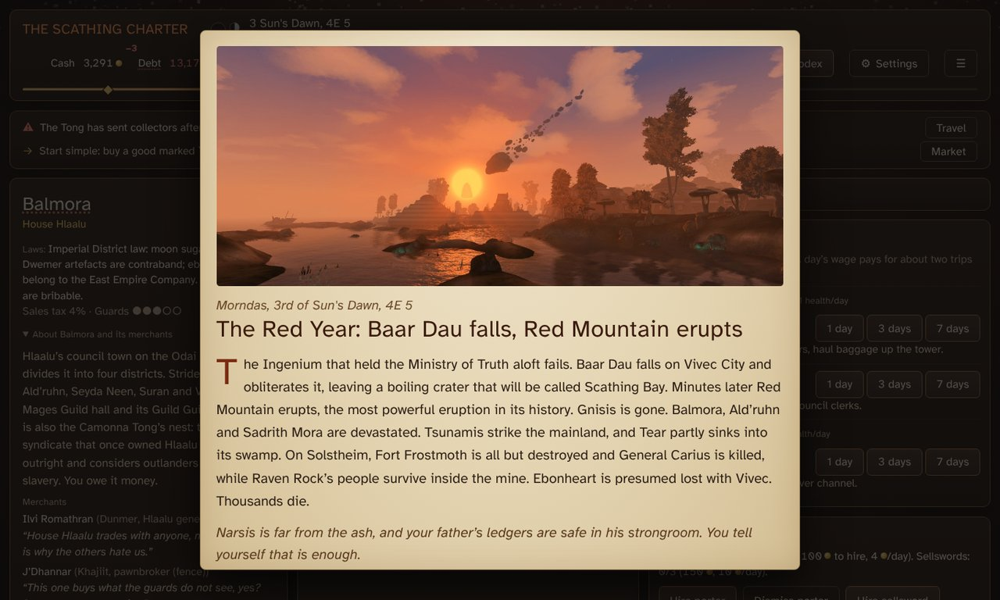
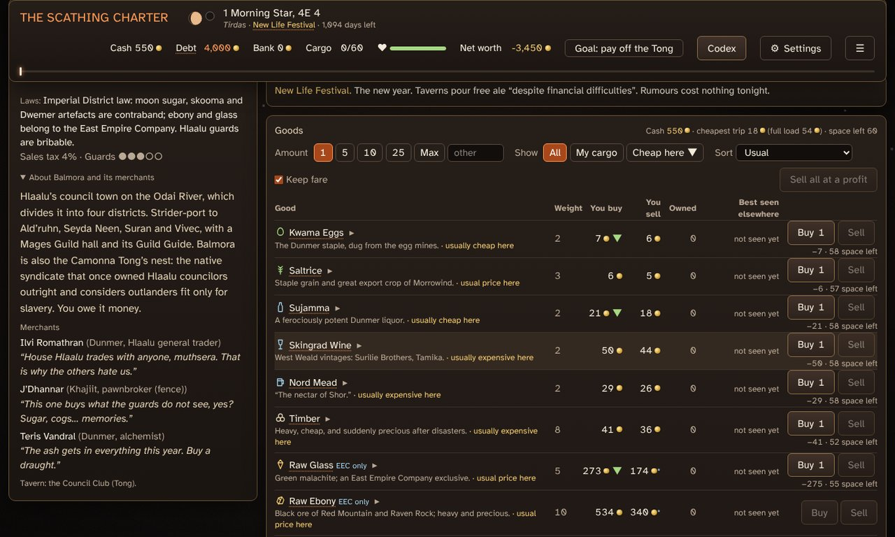
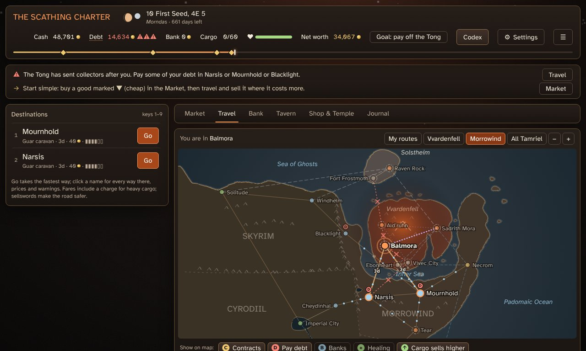
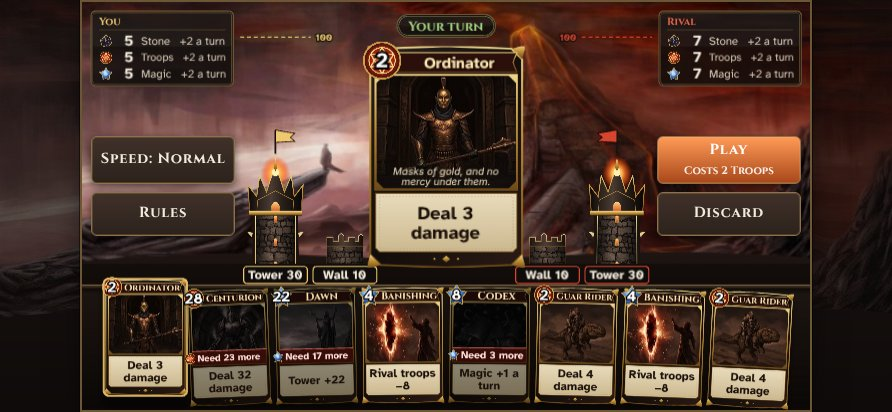
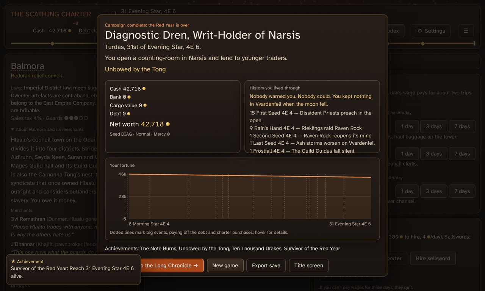

# The Scathing Charter

*A Dope Wars–style trading game in Morrowind's Red Year. You know the mountain will fall. Your trader doesn't.*

It is **1 Morning Star 4E 4** in Balmora. You owe the Camonna Tong 4,000 septims, you own one pack guar,
and in a little over a year Baar Dau falls on Vivec and Red Mountain buries half the island. Buy low, sell
high, pay the Tong before the collectors come, and decide where your money sleeps when the sky goes red.
Live through it, and the **Scathing Charter**, the right to rebuild what's left, is for sale.

- **History keeps its own calendar.** 25 world events happen on their real dates, from the Red Year to the
  Argonian invasion, and 93 rumours try to warn you first. The markets, roads and towns change with them.
- **Everything comes from the lore.** 20 places, 16 goods and 236 codex entries, each with sources you can
  click. Anything invented says so.
- **A tower duel in court.** When the guards fine you or seize your goods, contest it before the magistrate in
  a card game of walls and towers.
- **The ending remembers.** It tells you how many times you were warned, and what you left in the vaults anyway.

**[▶ Play it in your browser](https://ullafreehum.github.io/scathing-charter/)**: free, nothing to install.
Windows and Android downloads are [below](#-play).

<table>
<tr>
<td width="50%"> A market day in Balmora. Green ▼ is cheap here.</td>
<td width="50%"> After the eruption the roads close and trade moves to the mainland.</td>
</tr>
<tr>
<td width="50%"> The tower duel on an Android phone.</td>
<td width="50%"> The end screen: your fortune, and the history you lived through.</td>
</tr>
</table>

## ▶ Play

It's free, and there are three ways in:

- **In your browser:** **[play online](https://ullafreehum.github.io/scathing-charter/)**. Nothing to install.
- **On Windows:** from the **[latest release](https://github.com/ullafreehum/scathing-charter/releases/latest)**,
  take **`ScathingCharter-Setup-….exe`** to install, or **`ScathingCharter-Portable-….exe`** to run it without
  installing. If Windows says *"Windows protected your PC"*, click **More info**, then **Run anyway**
  (the game isn't signed).
- **On Android:** from the same release, take **`ScathingCharter-…-Android.apk`** and open it on your phone
  (allow installs from unknown sources when asked). It works on any phone held sideways.

On a Mac or Linux, play in the browser. What changed in each version is in the [changelog](CHANGELOG.md).

## 🎲 Your first game

1. Click **New game**, pick a character and choose **Easy (Fair Terms)**.
2. In the **Tavern**, buy a round: rumours are free on the first night and give price tips.
3. In the **Market**, buy a good marked with a green **▼** (cheap here).
4. On the **Travel** map, pick a town and **Go**. Sell there if the price is higher (**▲**).
5. Back in Balmora, pay some of your debt on the **Bank** tab before the Tong sends collectors.

Keep an eye on the rumours. History in this game happens on real dates, and it does not care where you keep
your money.

## 💡 Good to know

- **Saves** happen after every action. **☰ → Save to slot** keeps extra copies, and **Export save file**
  makes a backup you can **Import** on another computer.
- **⚙ Settings** has colour themes, fonts, text size, falling ash, Reduce motion, sound effects and music.
- **On Windows**, **F11** switches full screen and **Ctrl+Plus / Ctrl+Minus** change the size of everything.
- **Card duel (practice)** on the title screen plays the magistrate's card hearing on its own.
- The art book: **[Art of the Red Year](docs/artbook/scathing-charter-artbook.pdf)** (PDF).

<b>📖 How to play: the full reference</b>

- **Goal:** pay off the Camonna Tong, then buy the Scathing Charter before the end of 4E 6. If your debt passes
  six times the note, the Tong puts its mark on you and the game ends. Otherwise you retire at the end, ranked
  by net worth (cash + deposits + cargo − debt).
- **Market:** one **Amount** drives every Buy and Sell button. **Best seen elsewhere** is your own price book.
  Big trades move the price, and selling a lot floods a market for a few weeks.
  **Contraband** sells only to fences, and **EEC** goods (ebony, glass, stalhrim) only to Company factors.
- **Travel:** every route costs days, a fare and some danger. Click a town for every way there and a price
  outlook. **Plan this route** chains far journeys. If you're broke, you can work your passage.
- **Bank:** Gavas Drelloth's mood shows how patient the Tong still is. Each bank city has a strongbox: safe
  from robbers, but not from history.
- **The Scathing Charter:** after the Red Year, with the debt paid, buy a relief licence, then a warehouse,
  then the full charter (Bank tab). Renew it when the council changes hands.
- **Tavern:** rumours, contracts, porters and sellswords, day labour and rest.
- **Shop & Temple:** carts and holds, weapons and armour, scrolls and healing.
- **Journal:** your own account of the journey. It reads differently once the Red Year has come.
- **Road events:** each choice shows its real chance of success. Smuggling draws the Legion's attention.
- **Long Chronicle:** finish the Red Year alive and in profit to carry on to the coronation of Titus Mede I.
- **Keyboard:** `m` Market, `t` Travel, `b` Bank, `v` Tavern, `s` Shop & Temple, `j` Journal, `c` Codex,
  `1`–`9` and `Enter` on the Travel tab, `Esc` to close.
- **Codex badges** (*Unverified*, *Historians disagree*, *Extrapolation*, *Invented for this game*) say how
  sure the lore is.

## 🧑‍💻 For developers

`npm install`, then `npm start` (dev server), `npm run check` (typecheck, lint, unit tests) and
`npm run test:e2e` (browser tests). The desktop app builds with `npm run desktop` / `npm run package:win`,
the Android app with `npm run android:sync`. Architecture and conventions: [`CLAUDE.md`](CLAUDE.md).
Design: [`docs/GAME_DESIGN.md`](docs/GAME_DESIGN.md). Lore, sources and disputes:
[`docs/LORE_BIBLE.md`](docs/LORE_BIBLE.md).

> Unofficial, non-commercial fan game. *The Elder Scrolls* is a trademark of ZeniMax Media / Bethesda
> Softworks. This project is not affiliated with or endorsed by them.
